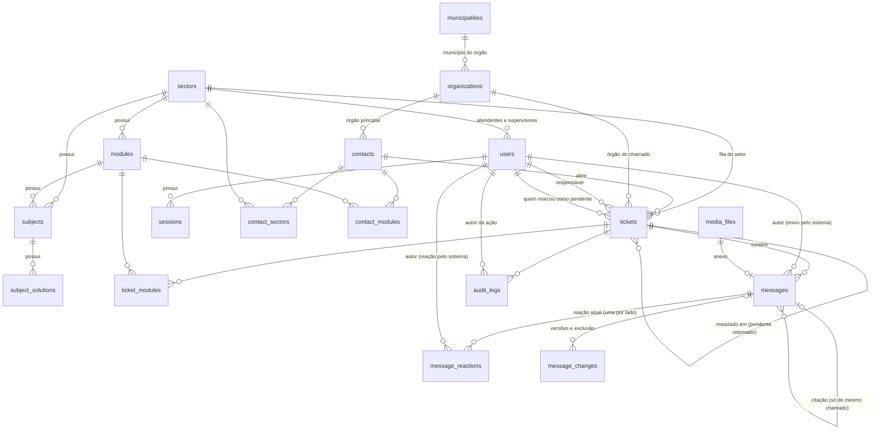
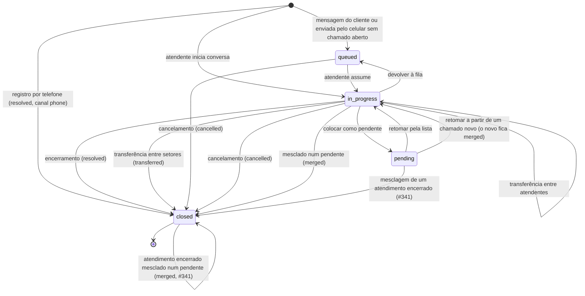

# Modelo de dados — Central de atendimento via WhatsApp

Domínios, entidades, ligações e regras de integridade. As regras de negócio estão em [features/](features/), as globais em [spec.md](../spec.md) e as decisões técnicas em [architecture.md](architecture.md).

Nomes de tabelas, colunas e valores estão em inglês, como no código. Todas as tabelas usam `id bigint generated always as identity` como chave primária e registram `created_at timestamptz not null default now()`; a exceção é `messages.created_at`, que usa `clock_timestamp()` para gravar o instante da mensagem e não o início da transação, senão uma mensagem gravada por uma transação já aberta ficaria com horário anterior à leitura e nunca contaria como não lida. Tabelas editáveis também têm `updated_at`. Horários são sempre `timestamptz`.

## Domínios

| Domínio | Pacote Go | Entidades | Responsabilidade |
| --- | --- | --- | --- |
| Organização interna | `internal/core/sectors` | Setor, Módulo | Setores e a lista de módulos de cada um |
| Conexão do número | `internal/helpdesk` | — (colunas do WhatsApp em Setor) | Ligar e desligar o número de WhatsApp de cada setor |
| Acesso | `internal/core/auth`, `internal/core/users` | Usuário, Sessão, Tentativas de login | Login, papéis e permissões; cadastro de usuários e senhas |
| Cadastro de clientes | `internal/core/directory` | Município, Órgão, Contato | Pessoas atendidas, os órgãos a que pertencem e os municípios desses órgãos |
| Atendimento | `internal/helpdesk` | Chamado, Módulos do chamado, Contador de protocolo, Assunto, Solução | Ciclo de vida do chamado: fila, responsável, transferências, encerramento e correções; listas de assuntos e soluções do formulário |
| Mensagens | `internal/helpdesk` | Mensagem, Arquivo | Histórico de mensagens e anexos |
| Mensageria | `internal/helpdesk/messaging` | — (sessões do Whatsmeow) | Interface de envio e recebimento e implementação com Whatsmeow |
| Auditoria | `internal/core/audit` | Registro de auditoria | Histórico de alterações relevantes |

As dependências entre os pacotes estão em [architecture.md](architecture.md), Estrutura do repositório.

## Diagrama

## Tipos enumerados

| Tipo | Valores | Significado |
| --- | --- | --- |
| `user_role` | `agent`, `supervisor`, `admin` | Atendente, supervisor do setor, administrador (supervisor global) |
| `connection_status` | `disconnected`, `connecting`, `connected`, `logged_out` | Estado da conexão do número do setor; `logged_out` exige novo QR code |
| `ticket_status` | `queued`, `in_progress`, `pending`, `closed` | Na fila sem responsável, com responsável, pendente (parado com motivo, sem responsável, à espera de ser retomado; spec [#332](https://github.com/gcaspp-labs/xet/issues/332)), encerrado |
| `ticket_channel` | `whatsapp`, `phone` | Canal do chamado: WhatsApp (mensagem recebida, enviada pelo celular ou Novo chamado) ou Telefone (registro por telefone, que já nasce encerrado) |
| `closure_type` | `resolved`, `transferred`, `cancelled`, `merged` | Encerrado normalmente, etapa encerrada por transferência entre setores, cancelado sem lançar o atendimento ou mesclado num pendente (as mensagens passaram para o chamado de `merged_into_ticket_id`; não conta como encerrado) |
| `message_direction` | `inbound`, `outbound` | Recebida do cliente ou enviada pelo setor |
| `message_origin` | `customer`, `agent`, `phone` | Enviada pelo cliente, por um atendente no sistema ou pelo celular fora do sistema |
| `message_change_kind` | `original`, `edit`, `deletion` | Linha de `message_changes` |
| `message_deletion_scope` | `everyone`, `local` | Alcance da exclusão |
| `message_type` | `text`, `image`, `video`, `audio`, `document`, `contact`, `unsupported`, `media_unavailable` | `contact` é o cartão de contato do WhatsApp, com os cartões em `messages.contact_cards` (#323; os contatos recebidos antes, gravados como `unsupported`, ficam como estão, sem conversão); `unsupported` cobre figurinhas, localização e outros tipos fora do piloto (as reações recebidas deixaram de ser gravadas como mensagem: vão para `message_reactions`; as antigas, já gravadas como `unsupported`, ficam como estão); `media_unavailable` é o arquivo recebido acima do limite ou que não baixou |
| `message_status` | `pending`, `sent`, `delivered`, `read`, `failed` | Situação de entrega das mensagens enviadas |
| `reaction_side` | `customer`, `sector` | Lado da reação: do cliente ou do número do setor |

## Organização interna

### `sectors` — Setor

| Coluna | Tipo | Regras |
| --- | --- | --- |
| `name` | text | Obrigatório, único |
| `email` | text | Opcional; único quando preenchido, sem diferenciar maiúsculas (`sectors_email_key`); vazio é gravado como nulo. Só cadastro: o sistema não envia e-mails |
| `phone` | text | Opcional; único quando preenchido, somente dígitos com DDI (ex.: `5511999990000`); vem do número lido no QR code e é apagado ao desvincular; a migração apagou o digitado em setores sem conta vinculada |
| `provider` | text | Obrigatório; provedor de mensageria do setor: `whatsmeow` (piloto) ou `cloud_api` (futuro) |
| `external_account_id` | text | Identificador da conta no provedor (no Whatsmeow, o JID do aparelho vinculado após o QR code) |
| `connection_status` | connection_status | Padrão `disconnected` |
| `last_connected_at` | timestamptz | Última conexão bem-sucedida |
| `connection_error` | text | Motivo da recusa da última conexão (número já ligado a outro setor); limpo na conexão seguinte |
| `active` | boolean | Padrão `true` |

### `modules` — Módulo/sistema atendido pelo setor

| Coluna | Tipo | Regras |
| --- | --- | --- |
| `sector_id` | bigint → `sectors` | Obrigatório |
| `name` | text | Obrigatório; único por setor (sem diferenciar maiúsculas) |
| `active` | boolean | Padrão `true` |

Módulos não são excluídos, apenas desativados, porque encerramentos antigos continuam referenciando-os. Módulos inativos não aparecem para novos encerramentos.

## Acesso

### `users` — Usuário

| Coluna | Tipo | Regras |
| --- | --- | --- |
| `name` | text | Obrigatório |
| `email` | text | Obrigatório, único (sem diferenciar maiúsculas) |
| `nickname` | text | Obrigatório no banco, não vazio, único sem diferenciar maiúsculas (`users_nickname_key`), inclusive entre inativos. Vazio no formulário ou na API grava o primeiro e o último nome de `name`. A migração preenche os existentes da mesma forma; em caso de repetição, o usuário de menor `id` fica com o apelido, e os demais recebem " 2", " 3"... |
| `password_hash` | text | bcrypt |
| `role` | user_role | Obrigatório |
| `sector_id` | bigint → `sectors` | Obrigatório para `agent` e `supervisor`; vazio para `admin` |
| `active` | boolean | Padrão `true`; usuário inativo não faz login |

Restrição: `(role = 'admin') = (sector_id is null)`.

Usuários não são excluídos, apenas desativados, porque continuam como autores de mensagens, chamados e auditoria. Com o usuário travado, a desativação e a troca de setor (inclusive ao virar administrador, que não tem setor) são recusadas se houver chamados `in_progress` com ele como responsável.

#### Permissões

As permissões de cada papel são regra de negócio e ficam em [features/access.md](features/access.md).

### `sessions` — Sessão de login

| Coluna | Tipo | Regras |
| --- | --- | --- |
| `token_hash` | text | Único; hash SHA-256 do token do cookie (o token em si nunca é gravado) |
| `user_id` | bigint → `users` | Obrigatório |
| `expires_at` | timestamptz | Obrigatório |
| `last_seen_at` | timestamptz | Atualizado no uso |

Um novo token é gerado a cada login. Desativar um usuário ou redefinir sua senha remove suas sessões. A expiração é deslizante: cada uso válido leva `expires_at` para 12 horas à frente. Sessões expiradas são apagadas periodicamente pelo serviço.

### `login_attempts` — Tentativas de login

Contagem de tentativas erradas por e-mail e por IP, sem ligação com `users`, porque e-mail não cadastrado também conta.

| Coluna | Tipo | Regras |
| --- | --- | --- |
| `scope` | text | `email` ou `ip`; check |
| `subject` | text | E-mail em minúsculas ou IP |
| `failures` | integer | Tentativas erradas seguidas |
| `last_failure_at` | timestamptz | Obrigatório; depois de 15 minutos a contagem recomeça |
| `locked_until` | timestamptz | Fim do bloqueio; vazio sem bloqueio |

Chave primária: `(scope, subject)`. Cada tentativa é contada na linha travada antes de conferir a senha, para tentativas simultâneas não passarem do limite. O login certo apaga a linha do e-mail e devolve a tentativa ao IP; redefinir a senha apaga a linha do e-mail. Linhas sem bloqueio ativo e com mais de 15 minutos são apagadas junto com as sessões expiradas.

## Cadastro de clientes

### `municipalities` — Município

| Coluna | Tipo | Regras |
| --- | --- | --- |
| `name` | text | Obrigatório; único; com acentos ("Peruíbe") |
| `audesp_code` | char(4) | Obrigatório; único; 4 dígitos, mantendo o zero à esquerda (`0790`) |
| `ibge_code` | char(7) | Obrigatório; único; 7 dígitos (`3500105`). Acha o município devolvido pela consulta de CNPJ sem depender da grafia |

Dados de referência carregados por migração, sem tela de cadastro nem auditoria. Fonte dos códigos: [Cadastro Institucional do AUDESP](https://www.tce.sp.gov.br/audesp/documentacao/cadastro-institucional) (TCE-SP). Os nomes seguem a grafia atual da [lista de municípios do IBGE](https://servicodados.ibge.gov.br/api/v1/localidades/estados/35/municipios), porque as planilhas do AUDESP divergem entre si e trazem erros (Florínia em vez de Florínea, São Luís em vez de São Luiz do Paraitinga).

### `organizations` — Órgão

| Coluna | Tipo | Regras |
| --- | --- | --- |
| `name` | text | Obrigatório |
| `cnpj` | char(14) | Opcional; sem pontuação, com letras maiúsculas e dígitos (CNPJ numérico ou alfanumérico), validado pelos dígitos verificadores; único quando informado (índice único parcial) |
| `municipality_id` | bigint → `municipalities` | Obrigatório |

Índice único em `(municipality_id, lower(immutable_unaccent(name)))`: o nome não se repete no município, sem diferenciar maiúsculas nem acentos.

### `contacts` — Contato (pessoa física)

| Coluna | Tipo | Regras |
| --- | --- | --- |
| `name` | text | Obrigatório; para números desconhecidos, preenchido com o nome do perfil do WhatsApp ou o telefone |
| `phone` | text | Único quando preenchido, somente dígitos com DDI; obrigatório para contato cadastrado (vazio só em contato criado automaticamente sem telefone conhecido, identificado apenas por LID) |
| `external_contact_id` | text | Identificador do contato no provedor, usado para casar mensagens recebidas; único quando preenchido |
| `organization_id` | bigint → `organizations` | Órgão principal; vazio para contato ainda não vinculado |
| `registered` | boolean | `false` para contatos criados automaticamente a partir de número desconhecido, mesmo com o nome já salvo pelo atendente; `true` após cadastro pelo atendente com órgão ou importação com órgão |

Restrições: `registered` ⇒ `organization_id` e `phone` preenchidos (contato cadastrado pelo atendente sempre tem órgão e telefone).

O cadastro de contatos e órgãos é único para todos os setores. Os órgãos são pré-cadastrados por supervisores e administradores; no atendimento, o atendente apenas vincula a pessoa a um órgão existente.

Busca: por nome do contato ou do órgão (índice `pg_trgm` para busca parcial, sem diferenciar maiúsculas nem acentos), pelo nome do município do órgão (da mesma forma, sem índice próprio, porque a tabela tem só 645 linhas), por telefone e por CNPJ. Os filtros usam os índices de `contacts.organization_id` e de `organizations (municipality_id, ...)`. Os acentos são removidos pela extensão `unaccent`, por meio da função `immutable_unaccent(text)`, que fixa o dicionário para poder ser usada nos índices de nome.

CNPJ: desde julho de 2026 a Receita Federal emite CNPJ alfanumérico (IN RFB 2.229/2024): as 12 primeiras posições aceitam letras maiúsculas e dígitos, e os 2 dígitos verificadores continuam numéricos. A validação usa o cálculo do módulo 11 com o valor de cada caractere igual ao código ASCII menos 48, que vale também para o CNPJ numérico. CNPJ com todos os caracteres iguais é recusado.

Casamento de mensagens recebidas: números brasileiros podem chegar com ou sem o nono dígito, e o WhatsApp pode identificar contatos por LID em vez do telefone. A mensagem é ligada ao contato pelo `external_contact_id` resolvido pelo adaptador. Sem contato com esse identificador, procura-se o contato pelo telefone ou por sua variante com ou sem o nono dígito (celular brasileiro: `55` + DDD + `9` + 8 dígitos ou `55` + DDD + 8 dígitos começando por 6 a 9), preferindo o telefone exato; se ele ainda não tiver `external_contact_id`, passa a ter o identificador. Sem nenhum dos dois, é criado um contato com `registered = false`.

Corrida do nono dígito: a restrição de telefone único não vê as duas variantes como o mesmo número. Por isso, a recepção de mensagens e a importação tomam, na transação, uma trava consultiva (`pg_advisory_xact_lock`) pela variante mais curta do telefone antes de procurar e criar o contato. A importação toma as travas em ordem, para não haver impasse. O cadastro manual continua comparando só o telefone exato.

### `contact_sectors` — Setores do contato

| Coluna | Tipo | Regras |
| --- | --- | --- |
| `contact_id` | bigint → `contacts` | Chave primária composta |
| `sector_id` | bigint → `sectors` | Chave primária composta |

O setor organiza a lista de contatos e não restringe o acesso. O vínculo é criado no cadastro, na importação e, na mesma transação da ação, quando o contato escreve para o número do setor, recebe uma conversa iniciada por ele ou mensagem do celular do setor, ou é transferido para ele (`insert ... on conflict do nothing`). A migração preenche a tabela a partir dos chamados existentes; contatos sem chamado ficam sem setor até serem editados.

Índice: `(sector_id, contact_id)` para o filtro da lista.

### `contact_modules` — Módulos do contato

| Coluna | Tipo | Regras |
| --- | --- | --- |
| `contact_id` | bigint → `contacts` | Chave primária composta |
| `module_id` | bigint → `modules` | Chave primária composta |
| `sector_id` | bigint | Setor do módulo; `(module_id, sector_id)` → `modules` e `(contact_id, sector_id)` → `contact_sectors`, de modo que o módulo seja de um setor do contato; único com `contact_id` |

Opcional, com no máximo um módulo por setor do contato. Tirar um setor do contato remove o módulo desse setor na mesma transação (`on delete cascade`). Módulo novo precisa estar ativo; o já vinculado pode continuar depois de desativado. Vínculos de setores que o usuário não altera são preservados ao salvar (ver Permissões). Índice: `(module_id)` para o filtro da lista.

## Atendimento

Nota interna e "Falou com" saíram do modelo ([#173](https://github.com/gcaspp-labs/xet/issues/173)): a migração 00026 apagou a tabela `internal_notes`, a coluna `tickets.spoke_with` e o `spoke_with` das correções em `audit_logs` (o registro cuja única alteração era esse campo foi apagado).

### `tickets` — Chamado

| Coluna | Tipo | Regras |
| --- | --- | --- |
| `protocol` | text | Obrigatório, único; formato `AAAA-NNNNNN` |
| `sector_id` | bigint → `sectors` | Obrigatório |
| `contact_id` | bigint → `contacts` | Obrigatório |
| `organization_id` | bigint → `organizations` | Copiado do órgão principal do contato; editável no encerramento; obrigatório para encerrar, exceto no cancelamento e na transferência entre setores |
| `assignee_id` | bigint → `users` | Responsável atual; vazio na fila e no pendente (quem marcou fica em `pending_by_id`) |
| `status` | ticket_status | Obrigatório |
| `previous_ticket_id` | bigint → `tickets` | Chamado de origem em transferência entre setores; único |
| `created_by_id` | bigint → `users` | Preenchido quando o atendente iniciou a conversa |
| `arrived_at` | timestamptz | Obrigatório; primeira mensagem do chamado |
| `assigned_at` | timestamptz | Primeira vez que alguém assumiu; não muda em transferências nem ao devolver à fila; vazio em chamado cancelado direto da fila |
| `started_at` | timestamptz | Obrigatório; padrão `arrived_at`; editável no encerramento |
| `ended_at` | timestamptz | Preenchido ao encerrar; editável |
| `closed_at` | timestamptz | Momento real do encerramento; não editável |
| `closed_by_id` | bigint → `users` | Quem encerrou ou cancelou |
| `closure_type` | closure_type | Preenchido ao encerrar |
| `subject` | text | Obrigatório para encerrar, exceto no cancelamento e na transferência entre setores |
| `resolution` | text | Obrigatório para encerrar, exceto no cancelamento e na transferência entre setores |
| `transfer_reason` | text | Motivo da transferência entre setores, texto livre e opcional, na etapa de origem; vazio quando não informado (nunca em branco) |
| `channel` | ticket_channel | Obrigatório; padrão `whatsapp`. Os chamados anteriores à coluna ficaram `whatsapp` |
| `client_request_id` | uuid | Chave de idempotência do registro por telefone, gerada pela tela; único quando preenchido; vazio nos chamados do WhatsApp |
| `pending_reason` | text | Motivo da última vez em que o chamado ficou pendente, texto livre; não em branco quando preenchido. Sobrescrito a cada nova vez pendente (o histórico fica na auditoria e na conversa); continua preenchido depois de retomado |
| `pending_by_id` | bigint → `users` | Quem marcou como pendente da última vez; sobrescrito como o motivo |
| `pending_at` | timestamptz | Quando foi marcado como pendente da última vez; sobrescrito como o motivo |
| `merged_into_ticket_id` | bigint → `tickets` | Pendente em que o chamado foi mesclado (`closure_type = 'merged'`); vínculo próprio, sem relação com `previous_ticket_id`, que carrega o acesso da cadeia de transferências. Não é desfeito |
| `assignee_read_at` | timestamptz | Momento até onde o responsável atual leu o chamado (#313, spec #310); vazio na fila e no pendente. É o marco das não lidas: contam as mensagens recebidas do cliente no chamado gravadas depois dele. Gravado ao assumir, ao receber por transferência entre atendentes e ao criar o chamado pelo atendente; limpo ao devolver à fila e ao deixar em pendente, que não têm responsável. O momento é o do servidor (`clock_timestamp()`, o instante da gravação, não o início da transação) e só avança: marcar como lido com um horário anterior não volta o valor |

Restrições:

- `status in ('queued', 'pending')` ⇒ `assignee_id` vazio (`tickets_queued_unassigned`).
- `status in ('in_progress', 'closed')` ⇒ `assignee_id` preenchido (`tickets_assigned`).
- `status = 'pending'` ⇒ `pending_reason`, `pending_by_id` e `pending_at` preenchidos (`tickets_pending_fields`).
- `pending_reason` preenchido ⇒ não em branco (`tickets_pending_reason_not_blank`).
- `status = 'closed'` ⇒ `ended_at`, `closed_at`, `closed_by_id` e `closure_type` preenchidos e, exceto em `closure_type in ('cancelled', 'transferred', 'merged')`, também `organization_id`, `subject` e `resolution`. As transferências feitas com o formulário de encerramento, antes de [#243](https://github.com/gcaspp-labs/xet/issues/243), têm esses campos e continuam válidas.
- `transfer_reason` preenchido ⇒ não em branco.
- `closure_type = 'merged'` ⇔ `merged_into_ticket_id` preenchido; o mesclado não tem `subject` nem `resolution` (`tickets_merged_fields`). `merged_into_ticket_id` nunca é o próprio chamado (`tickets_merged_into_other`).
- `ended_at >= started_at`.
- `channel = 'phone'` ⇒ `status = 'closed'` e `closure_type = 'resolved'` (`tickets_phone_closed`): o registro por telefone nasce e fica encerrado.
- `client_request_id` único quando preenchido (`tickets_client_request_id_key`).
- Índice único parcial `tickets_open_contact_key` em `(sector_id, contact_id) where status in ('queued', 'in_progress')`: um chamado na fila ou em atendimento por contato e setor. Os pendentes ficam fora: um contato pode ter vários pendentes no setor e, ao mesmo tempo, um chamado na fila ou em atendimento. Neste documento e no código, "chamado aberto" quer dizer na fila ou em atendimento.
- Encerrar exige ao menos um registro em `ticket_modules` (validado na transação de encerramento), exceto na transferência entre setores.
- O contato do chamado precisa estar com `registered = true` para encerrar, exceto na transferência entre setores.

Não lidas (#313, spec #310). A quantidade é calculada na consulta da lista, sem contador guardado: `count(*)` das mensagens do chamado com `direction = 'inbound'` e `origin = 'customer'` gravadas depois de `assignee_read_at`. A comparação usa `messages.created_at`, o horário em que o servidor gravou a mensagem, e não `messages.sent_at`, que vem do relógio do celular: assim um relógio adiantado não esconde uma mensagem. Os dois lados usam `clock_timestamp()`, o instante da gravação, e não `now()`, o início da transação: uma mensagem gravada por uma transação que já estava aberta quando a leitura foi gravada continua depois dela e conta como não lida. Reações, edições e exclusões não criam mensagem e não entram na contagem (as duas últimas só atualizam `updated_at`). A mensagem enviada pelo XET ou pelo celular do setor é `outbound`, e a nota e o aviso do sistema não são mensagens, então também não contam. Os chamados em atendimento na migração receberam o momento dela, para começarem sem não lidas.

Índices: `(sector_id, status)` para a fila; `(assignee_id) where status = 'in_progress'` para a contagem por atendente; `(contact_id)` e `(organization_id)` para o histórico; `(sector_id, closed_at) where status = 'closed'` para os realizados do dia.

### `ticket_modules` — Módulos atendidos no chamado

| Coluna | Tipo | Regras |
| --- | --- | --- |
| `ticket_id` | bigint → `tickets` | Chave primária composta |
| `module_id` | bigint → `modules` | Chave primária composta; o módulo deve ser do setor do chamado |

### `subjects` — Assunto da lista do módulo

| Coluna | Tipo | Regras |
| --- | --- | --- |
| `sector_id` | bigint → `sectors` | Obrigatório |
| `module_id` | bigint → `modules` | Obrigatório ao criar ou editar; vazio nos assuntos anteriores até a classificação. A chave composta `(module_id, sector_id)` referencia o módulo do mesmo setor |
| `name` | text | Obrigatório, não em branco, até 500 caracteres; único por módulo, ignorando maiúsculas e espaços nas pontas; assuntos sem módulo são únicos entre si no setor |

A migração mantém os assuntos e suas soluções sem classificá-los. Assuntos são excluídos de verdade. `tickets.subject` guarda o próprio texto, sem ligação com esta tabela.

### `subject_solutions` — Solução da lista do assunto

| Coluna | Tipo | Regras |
| --- | --- | --- |
| `subject_id` | bigint → `subjects` | Obrigatório; `on delete cascade` |
| `body` | text | Obrigatório, não em branco, até 10.000 caracteres; único por assunto, sem diferenciar maiúsculas (`subject_solutions_subject_id_body_key`, em `(subject_id, md5(lower(body)))`, porque o texto pode passar do limite de tamanho do índice) |

Soluções são excluídas de verdade e não mudam de assunto. `tickets.resolution` guarda o próprio texto, sem ligação com esta tabela.

Ao salvar o formulário com "adicionar", o item é gravado na mesma transação do chamado, depois de travá-lo, com `on conflict do nothing`. A solução trava o assunto (`for share`) e, se ele não existir mais, não é gravada, sem erro.

### `protocol_counters` — Contador de protocolo

| Coluna | Tipo | Regras |
| --- | --- | --- |
| `year` | integer | Chave primária |
| `last_value` | integer | Último número usado no ano |

O protocolo é gerado na mesma transação que cria o chamado, com `insert ... on conflict (year) do update set last_value = last_value + 1 returning last_value`. A numeração é única para todos os setores e reinicia a cada ano, contado no horário de Brasília (`America/Sao_Paulo`).

### Ciclo de vida do chamado

| Evento | Efeito |
| --- | --- |
| Mensagem do cliente sem chamado aberto no setor | Cria chamado `queued` com `arrived_at` = horário da mensagem, mesmo que o contato tenha pendentes no setor |
| Mensagem do cliente com chamado aberto | Entra no chamado existente (`queued` ou `in_progress`); um pendente nunca recebe mensagem nova |
| Mensagem enviada pelo celular sem chamado aberto | Cria chamado `queued`; mensagem com origem `phone`, com a mesma regra dos pendentes |
| Edição, exclusão ou reação recebida sobre mensagem de um pendente | Atualiza a mensagem no próprio pendente, sem abrir chamado novo |
| Atendente inicia conversa | Cria chamado `in_progress` com `assignee_id` e `created_by_id` = atendente e `arrived_at` = envio; auditoria `ticket_started` na mesma transação |
| Registro por telefone | Numa só transação, sem passar pela fila e sem mensagens: protocolo da mesma sequência, chamado `closed` com `channel = 'phone'`, `closure_type = 'resolved'`, `assignee_id` e `closed_by_id` = quem registrou (`created_by_id` fica vazio: é de quem iniciou conversa), `arrived_at`, `assigned_at` e `started_at` = início informado, `ended_at` = fim informado, `closed_at = now()`, órgão, assunto, resolução e `client_request_id`; grava `ticket_modules` (módulos ativos do setor), os itens "adicionar à lista" e a auditoria `ticket_phone_registered`. O contato é travado para leitura (`for share`) e precisa estar cadastrado. O índice parcial de chamado aberto não o alcança, então um chamado aberto do contato no setor continua como está. O mesmo `client_request_id` devolve o mesmo chamado; com outro autor, é recusado. O aviso de chamado é publicado depois do commit |
| Assumir | `update ... set assignee_id = :user, status = 'in_progress', assigned_at = coalesce(assigned_at, now()) where id = :id and status = 'queued'`; nenhuma linha afetada significa que outro atendente assumiu antes |
| Transferência entre atendentes | Com o chamado travado (`for update`) e `in_progress`, troca `assignee_id`; auditoria `ticket_transferred_user` com `assignee_id` de/para na mesma transação. Repetir a transferência para quem já é o responsável não grava de novo |
| Encerramento | Com o chamado travado (`for update`), `in_progress` e o usuário como responsável, e o contato travado para leitura (`for share`) e cadastrado: preenche os campos de encerramento com `closure_type = 'resolved'`, `closed_at = now()`, `closed_by_id` = responsável e `ended_at` informado ou `now()`; grava `ticket_modules` (módulos ativos do setor) e a auditoria `ticket_closed` na mesma transação |
| Transferência entre setores | Com o chamado travado (`for update`), `in_progress` e o usuário como responsável, e o contato travado para leitura (`for share`), sem formulário e sem exigir o cadastro do contato: encerra com `closure_type = 'transferred'`, `closed_at = now()`, `closed_by_id` = responsável, `ended_at` = momento da transferência (um `started_at` à frente dele, vindo do relógio do celular, passa a ser o momento da transferência), `transfer_reason` quando informado, sem assunto, resolução nem módulos; cria chamado `queued` no destino (outro setor ativo) com `previous_ticket_id`, mesmo contato, o órgão principal do contato (vazio quando ele não tem) e `arrived_at` = momento da transferência. Se o contato já tiver chamado aberto no destino (índice único parcial), a transação é desfeita e a transferência recusada. Auditoria `ticket_transferred_sector` na origem, na mesma transação. Os eventos dos dois setores são publicados depois do commit |
| Cadastro do contato | Na mesma transação do cadastro, os chamados abertos do contato com `organization_id` vazio recebem o órgão do contato (travados com `for update`), com auditoria `ticket_organization_linked` em cada um |
| Correção | Com o chamado travado (`for update`) e `closed`, por quem encerrou (`closed_by_id`), supervisor do setor ou administrador: altera `subject`, `resolution`, `organization_id`, `started_at` e `ended_at` e acrescenta ou remove linhas de `ticket_modules` (acrescentadas só entre os módulos ativos do setor; as já gravadas podem ficar mesmo inativas); auditoria `ticket_corrected` com `reason` na mesma transação. Sem nenhuma alteração, nada é gravado. Chamado com `closure_type = 'transferred'` não é corrigido (recusa com conflito, sem gravar nada), nem o antigo, feito com o formulário |
| Devolver à fila | Com o chamado travado (`for update`) e `in_progress`, pelo responsável, supervisor do setor ou administrador: `status = 'queued'`, `assignee_id` vazio, `assigned_at` mantido; auditoria `ticket_returned` na mesma transação |
| Cancelamento | Com o chamado travado (`for update`) e aberto, conforme as permissões: `closure_type = 'cancelled'`, `closed_at` e `ended_at` = agora (`ended_at` nunca antes de `started_at`, que vem do relógio do celular), `closed_by_id` = quem cancelou; vindo da fila, `assignee_id` = quem cancelou, porque chamado encerrado exige responsável (`assigned_at` fica vazio). Não exige contato cadastrado nem `ticket_modules`; auditoria `ticket_cancelled` com `reason` na mesma transação. Chamado cancelado não é corrigido |
| Mensagem após encerramento | Cria novo chamado (não reabre) |
| Colocar como pendente | Com o chamado travado (`for update`), `in_progress` e o usuário como responsável (supervisor e administrador também precisam ser o responsável), e o contato travado para leitura (`for share`), com motivo não em branco: `status = 'pending'`, `assignee_id` vazio, `pending_reason`, `pending_by_id` = responsável e `pending_at = now()` (sobrescritos a cada vez), `assigned_at` mantido; nada é enviado ao cliente; auditoria `ticket_pending` na mesma transação. A trava do chamado é a mesma que a mensagem recebida espera: depois do commit, a mensagem não o encontra como aberto e cria um chamado `queued`. O aviso de chamado é publicado depois do commit |
| Retomar pela lista ([#334](https://github.com/gcaspp-labs/xet/issues/334)) | Com o pendente e o contato travados: se o contato tiver chamado `queued` ou `in_progress` no setor, recusa sem mudar nada; senão `status = 'in_progress'`, `assignee_id` = quem retomou, `assigned_at` e os campos do pendente mantidos; auditoria `ticket_resumed` |
| Retomar a partir de um chamado novo ([#335](https://github.com/gcaspp-labs/xet/issues/335)) | Com A (pendente), B (`in_progress`, do usuário) e o contato travados, numa transação: as mensagens de B passam para A; B fica `closed` com `closure_type = 'merged'`, `merged_into_ticket_id` = A, `closed_at` e `ended_at` = agora e `closed_by_id` = quem mesclou, sem assunto, resolução nem módulos; A volta a `in_progress` com `assignee_id` = quem mesclou; auditoria `ticket_merged` em B e `ticket_resumed_by_merge` em A |
| Mesclar um atendimento encerrado num pendente ([#341](https://github.com/gcaspp-labs/xet/issues/341)) | Com A (pendente), B (`closed`, `resolved` ou `cancelled`) e o contato travados: as mensagens de B passam para A; A vai de `pending` a `closed` com o `closure_type` e os dados de encerramento de B; B passa a `closure_type = 'merged'` com `merged_into_ticket_id` = A, sem assunto, resolução nem módulos; auditoria `ticket_merged` em B e `ticket_closed_by_merge` em A. É a única saída de `pending` direto para `closed` |

Chamados não são reabertos: o pendente não foi encerrado, e o mesclado não é reaberto. Encerrar, cancelar, devolver à fila e transferir (para outro atendente ou setor) não valem para `pending`; o pendente é retomado antes, a não ser na mesclagem de um atendimento encerrado. O destino de uma transferência entre setores vê o histórico seguindo a cadeia de `previous_ticket_id`: quem tem acesso ao setor de um chamado lê também todos os chamados anteriores da cadeia (detalhe, mensagens, arquivos, módulos e correções), sem poder agir neles. A origem vê o setor e o protocolo do chamado seguinte, sem acesso a ele; o motivo da transferência (`transfer_reason`) fica registrado no próprio chamado de origem.

## Mensagens

### `messages` — Mensagem

| Coluna | Tipo | Regras |
| --- | --- | --- |
| `ticket_id` | bigint → `tickets` | Obrigatório |
| `sector_id` | bigint → `sectors` | Obrigatório; número pelo qual a mensagem passou |
| `contact_id` | bigint → `contacts` | Obrigatório |
| `direction` | message_direction | Obrigatório |
| `origin` | message_origin | Obrigatório |
| `author_id` | bigint → `users` | Obrigatório quando `origin = 'agent'`; vazio nos demais |
| `type` | message_type | Obrigatório |
| `body` | text | Texto ou legenda. Com `origin = 'agent'`, guarda o texto como foi enviado, com o prefixo do apelido (`nickname`), exceto em `audio` |
| `media_id` | bigint → `media_files` | Anexo, quando houver |
| `external_message_id` | text | Identificador da mensagem no provedor; preenchido na recepção ou após o envio aceito |
| `client_request_id` | uuid | Gerado pela interface a cada envio; impede envio duplicado em clique duplo ou nova tentativa |
| `status` | message_status | Usado nas mensagens enviadas |
| `failure_reason` | text | Motivo quando `status = 'failed'` |
| `sent_at` | timestamptz | Obrigatório; horário da mensagem segundo o WhatsApp |
| `quoted_external_message_id` | text | Identificador no provedor da mensagem citada (resposta citada); vazio quando não há citação identificada |
| `quoted_message_id` | bigint → `messages` | Ligação com a mensagem citada, **só quando ela está no mesmo chamado**; vazio se o XET não a tem ou se ela é de outro chamado |
| `quoted_type` | message_type | Tipo do trecho citado que veio do provedor; vazio quando o provedor não entrega o trecho |
| `quoted_body` | text | Texto do trecho citado: o texto, a legenda (imagem e vídeo) ou o nome do arquivo (documento; a legenda, se não houver nome); vazio em áudio e quando o provedor não entrega |
| `edited_at` | timestamptz | Horário da versão atual segundo o provedor; vazio quando a mensagem nunca foi editada por fora do sistema (#291) |
| `deleted_at` | timestamptz | Horário da exclusão segundo o provedor; vazio quando a mensagem não foi excluída. É um estado à parte de `status` (a situação de entrega não muda) |
| `deletion_scope` | message_deletion_scope | `everyone` ou `local`; preenchido junto com `deleted_at`. Uma exclusão para todos — vinda de fora ou do próprio XET — amplia um `local` já gravado para `everyone` |
| `deletion_origin` | message_origin | Quem excluiu (cliente, celular do setor ou atendente); preenchido junto com `deleted_at` |
| `contact_cards` | jsonb | Cartões da mensagem `contact`, em ordem: lista não vazia de `{"name", "organization", "phones": [{"phone", "wa_id"}]}`; vazio (`null`) nos demais tipos |

Restrições:

- Único em `(sector_id, external_message_id)` quando preenchido: garante idempotência em reconexões e reentregas.
- Único em `client_request_id` quando preenchido: garante idempotência no envio pelo sistema.
- `direction = 'inbound'` ⇔ `origin = 'customer'`.
- `type = 'contact'` ⇔ `contact_cards` preenchido, e preenchido é sempre uma lista com ao menos um cartão (`messages_contact_cards`).
- `type in ('image', 'video', 'audio', 'document')` ⇒ `media_id` preenchido. `media_unavailable` não tem `media_id`; `body` guarda a legenda ou o nome do arquivo.
- Ligação, tipo ou texto da citação ⇒ `quoted_external_message_id` preenchido (`messages_quote_external_id`); `quoted_body` ⇒ `quoted_type` (`messages_quote_body_type`).
- `deleted_at`, `deletion_scope` e `deletion_origin` são preenchidos juntos ou ficam todos vazios (`messages_deletion_state`).
- Chave estrangeira `(quoted_message_id, ticket_id)` → `messages (id, ticket_id)` (`messages_quote_same_ticket`, com o único `messages_id_ticket_id_key`): a ligação só aponta para mensagem do mesmo chamado, para a citação nunca expor o conteúdo de outro chamado.

Índice: `(ticket_id, sent_at)` para exibir a conversa.

Mensagens enviadas pelo celular fora do sistema (`origin = 'phone'`) são gravadas com `status = 'sent'`, sem autor.

Mensagens enviadas pelo sistema são gravadas como `pending` (com `sent_at` no momento do registro) e passam a `sent` com o `external_message_id` quando o provedor aceita, ou a `failed` com `failure_reason`. As confirmações do provedor só avançam a situação (`sent` → `delivered` → `read`); uma falha informada pelo provedor só vale para mensagens `pending` ou `sent`, e uma entrega confirmada vale também sobre `failed`. O reenvio pelo responsável volta a mensagem de `failed` para `pending` com a mesma chave de idempotência (`client_request_id`).

Mensagens não são apagadas nem sobrescritas sem registro (#291, spec #290). Edições e exclusões para todos feitas pelo cliente ou pelo celular do setor são gravadas na própria mensagem, sem criar mensagem nem chamado, inclusive em chamado encerrado. `body` mostra a versão atual e `edited_at` o horário dela; a exclusão marca `deleted_at`, `deletion_scope` e `deletion_origin`, e o conteúdo, o arquivo e a situação de entrega continuam gravados. O histórico fica em `message_changes` (abaixo). A API de mensagens devolve `editedAt` e `deletion` (`at`, `scope`, `origin`), de forma aditiva; a ocultação do conteúdo excluído é da tela, não da API.

Uma exclusão para todos **amplia** uma exclusão `local` já gravada (#375): `MarkMessageDeleted` só aceita essa troca, e o alcance passa a `everyone` mantendo `deleted_at` e `deletion_origin` da primeira exclusão, porque o conteúdo está oculto desde então e por aquela origem. O histórico guarda as duas exclusões, em ordem, cada uma com a origem e o horário. Em Chamados, por isso, o conteúdo continua oculto pela origem da primeira exclusão, e a prévia da lista de chamados continua sem ele.

A mesma regra vale quando a ampliação de `local` para `everyone` é feita pelo próprio XET, não só pelo celular: a exclusão para todos pedida no sistema sobre uma mensagem já excluída "para mim" (por exemplo, quando o provedor confirma tarde uma ação que ficou incerta e o eco chega depois) também passa o alcance a `everyone` e mantém `deleted_at` e `deletion_origin` da primeira exclusão. Aí a origem é `agent` nas duas.

A imutabilidade da mensagem foi revista pela spec #290: o texto e a legenda podem ser revistos, pelo WhatsApp e pelo XET, e o que cai é a regra antiga de que a mensagem nunca é editada ou excluída. Nada é apagado nem sobrescrito sem registro: cada versão anterior fica em `message_changes`, o conteúdo excluído continua gravado em `body` e em `media_id`, e `status` segue a situação de entrega sem representar a exclusão.

Citação (resposta citada, #201). Escolha de armazenamento: colunas em `messages`, em vez de tabela própria, porque a citação é no máximo uma por mensagem, nasce com ela e nunca muda (a citação não é refeita quando a mensagem é editada). A citação inteira é opcional, e o trecho também: o provedor pode entregar a mensagem sem citação, só com o identificador da citada, ou com identificador e trecho, e as três são gravadas normalmente. Regras de gravação (`helpdesk/inbound.go`), para a mensagem recebida e a enviada pelo celular do setor: com o chamado travado, a ligação procura a citada pelo identificador externo **no mesmo chamado**; se ela não está lá (de antes do XET, de outro chamado, mesmo do mesmo contato, ou ainda não chegou), fica sem ligação e com o trecho do provedor, se houver. O trecho é o que o provedor entrega, não uma cópia da mensagem ligada; a mídia da citação não é baixada nem guardada. Na resposta citada enviada pelo responsável (`helpdesk/send.go`, #202), com o chamado travado, a citada precisa ser do mesmo chamado, ter `external_message_id` (recebida, ou enviada com situação `sent`, `delivered` ou `read`) e não ser `unsupported`; a ligação é sempre gravada, e o trecho é tirado da mensagem citada pela mesma regra do trecho recebido (o texto como o cliente o viu, com o apelido, se for do setor; a legenda; o nome do documento; nada no áudio; a legenda ou o nome em `media_unavailable`). A API devolve a ligação, o tipo e o texto do trecho; sem trecho e com ligação, a tela usa a mensagem ligada, e sem os dois mostra "mensagem indisponível". Editar ou excluir a mensagem citada não reescreve o trecho retroativamente: o `quoted_body` das respostas que a citaram e o da própria resposta ficam como foram gravados, porque a citação é o que o cliente viu quando a resposta saiu.

Cartões de contato (#323, spec #312). Escolha de armazenamento: uma coluna `jsonb` em `messages`, em vez de tabela própria, porque os cartões nascem com a mensagem e nunca mudam, como a citação: são o que o cliente enviou (ou o que o setor enviou), sem ligação com `contacts`, e o cartão não muda se o cadastro mudar. A mensagem pode trazer vários cartões, em ordem, e cada cartão vários telefones; uma tabela pediria duas (cartões e telefones) só para ler tudo junto com a mensagem, sem nenhuma consulta pelos campos de dentro. Cada cartão tem `name` (obrigatório, não vazio), `organization` (o órgão, opcional; no enviado, com o município) e `phones` (lista, pode ser vazia), e cada telefone tem `phone` (só dígitos) e `wa_id` (o identificador do WhatsApp, quando o provedor informa). A conferência da forma de cada cartão é do código (`helpdesk`); o banco garante que a mensagem `contact` tenha a lista e que só ela a tenha. `body` fica vazio na mensagem `contact`. A recepção segue as regras de sempre (chamado, idempotência por `external_message_id`, aviso pelo WebSocket); a API de mensagens devolve `contactCards` e a última mensagem das listas (`lastMessage`) traz o nome do primeiro cartão (`contactName`), de forma aditiva.

No envio (#324), o responsável escolhe um contato do cadastro (só `registered`, com telefone), e o backend grava um cartão com o nome, o telefone (`wa_id` vazio: o provedor o descobre no envio) e o órgão com o município (`"Órgão — Município"`), sem o apelido de quem enviou e sem texto em `body`. O envio segue as regras das outras mensagens (`pending` → `sent` ou `failed`, `client_request_id`, "Reenviar" com o cartão gravado), e citar uma mensagem `contact` grava `quoted_type = 'contact'` e, em `quoted_body`, o nome do primeiro cartão. Sem mudança de esquema.

Reverter a migração (`down`) só é possível sem mensagens `contact`: apagá-las perderia mensagens. O valor `contact` fica no tipo `message_type`, porque o Postgres não remove valor de enum.

### `message_changes` — Histórico de alterações da mensagem

Registro de alteração da mensagem (#291). **Só cresce:** nada é alterado nem excluído; a única atualização permitida é ligar `message_id` uma vez, quando a mensagem alvo chega. Não há linha em `audit_logs` para essas alterações, para não duplicar o registro.

Cada linha é uma versão (a original ou uma edição) ou uma exclusão. A original só vira linha na **primeira edição**; mensagens antigas não são preenchidas.

| Coluna | Tipo | Regras |
| --- | --- | --- |
| `sector_id` | bigint → `sectors` | Obrigatório; número pelo qual a alteração passou |
| `message_id` | bigint → `messages` | Vazio enquanto a alteração espera a mensagem original (pendente); ligado quando ela é gravada |
| `target_external_message_id` | text | Identificador externo da mensagem alvo; obrigatório quando `message_id` é vazio |
| `kind` | message_change_kind | `original`, `edit` ou `deletion` |
| `origin` | message_origin | Quem alterou: cliente, celular do setor ou atendente |
| `author_id` | bigint → `users` | Só quando `origin = 'agent'` |
| `external_contact_id`, `phone` | text | Contato informado pelo provedor, para conferir uma alteração pendente com o contato da mensagem |
| `body` | text | Texto da versão; vazio na exclusão |
| `deletion_scope` | message_deletion_scope | Obrigatório na exclusão e só nela |
| `external_event_id` | text | Identificador da alteração no provedor, quando informado; vazio na original |
| `occurred_at` | timestamptz | Obrigatório; horário da alteração segundo o provedor |
| `created_at` | timestamptz | Quando o XET gravou |

Restrições: único `(sector_id, external_event_id)` quando preenchido (reentrega e eco do mesmo evento não gravam de novo); uma só original por mensagem; `original` exige `message_id` e não tem `external_event_id`.

Regras de gravação (`helpdesk`, `recordChange`): trava `(setor, identificador externo)`, depois o contato e o chamado, sempre nessa ordem. Evento já visto não grava nada. Mensagem ainda desconhecida: a alteração fica pendente e é ligada quando a original é gravada (recebida, enviada pelo celular ou enviada pelo XET); a reentrega do mesmo evento repara uma ligação que faltou. Mensagem conhecida: a primeira edição guarda a original; `body` só muda se a edição for a mais nova (horário, depois ordem de chegada); uma edição mais antiga vira versão no histórico sem mudar o texto, e texto igual a um anterior é versão nova, não eco. Uma exclusão para todos sobre uma exclusão para mim já gravada amplia o alcance para `everyone` e entra no histórico, mantendo `deleted_at` e `deletion_origin` da primeira; sobre uma mensagem já excluída para todos, não grava nada. Autor impossível (cliente editando mensagem do setor, celular editando mensagem do cliente, outro contato) é descartado. O aviso do chamado vai pelo WebSocket depois do commit; alteração pendente não avisa.

Reverter a migração (`down`) remove as colunas e a tabela: as mensagens ficam, mas o histórico de versões e o estado de exclusão se perdem, e `body` fica com a última versão.

Consulta (`helpdesk/message_versions.go`, `MessageChanges`): as versões e a exclusão de uma mensagem são lidas por quem já vê o chamado, aberto ou encerrado, e por ninguém mais, com o mesmo isolamento de setor e de chamado da mensagem; o arquivo da versão atual continua sujeito à permissão do anexo. É só leitura: nenhuma rota altera ou apaga linha de `message_changes`, e a tela só oferece a consulta em Atendimentos.

### `message_reactions` — Reação atual da mensagem

Escolha de armazenamento (#197): uma tabela pequena, em vez de colunas em `messages`, porque a reação tem dados próprios (autor, origem, horário) e muda sem que a mensagem mude. Cada mensagem guarda no máximo **duas reações atuais**, uma por lado, sem histórico de trocas.

| Coluna | Tipo | Regras |
| --- | --- | --- |
| `message_id` | bigint → `messages` | Obrigatório; parte da chave primária |
| `side` | reaction_side | Obrigatório; `customer` (o cliente) ou `sector` (o número do setor); parte da chave primária |
| `emoji` | text | Não vazio, ou vazio (`null`) quando a reação foi removida: a linha fica só para guardar o horário da remoção. A API mostra o lado como `null` |
| `author_id` | bigint → `users` | Atendente que reagiu pelo sistema; só no lado `sector`; vazio quando a reação veio do celular ou o provedor não informa |
| `via_phone` | boolean | `true` quando o provedor informa que a reação do setor foi feita pelo celular, fora do sistema; nunca junto com `author_id`; sempre `false` no lado `customer` |
| `reacted_at` | timestamptz | Obrigatório; horário da última alteração do lado (reação ou remoção) segundo o provedor |

Restrições:

- Chave primária `(message_id, side)`: uma reação por lado; a nova do mesmo lado substitui a anterior.
- `side = 'customer'` ⇒ `author_id` vazio e `via_phone` falso (`message_reactions_customer_side`).
- `author_id` preenchido ⇒ `via_phone` falso (`message_reactions_author_or_phone`).
- `emoji` vazio (removida) ⇒ `author_id` vazio e `via_phone` falso (`message_reactions_removed`).

Regras de gravação (`helpdesk/reactions.go`): o chamado da mensagem é travado (`for update`); reação a mensagem de chamado encerrado ou desconhecida é descartada, sem criar mensagem nem chamado. Um evento mais antigo que a última alteração gravada do mesmo lado, reação ou remoção, não muda nada, e o mesmo evento repetido também não: a remoção guarda o horário em vez de apagar a linha, então uma reação removida não volta quando um evento antigo é entregue de novo, e uma remoção que chega antes de uma reação mais antiga a descarta. No mesmo horário, a remoção vence a reação; entre reações do mesmo horário, vale a última recebida. Só muda o aviso ao painel quando o que o lado mostra muda: uma remoção sem reação a remover é gravada, mas não avisa.

Reação do setor pelo painel (`helpdesk/react.go`, #198): só o responsável, com o chamado aberto, reage a mensagem recebida ou enviada com identificador no WhatsApp (`sent`, `delivered` ou `read`). Com o chamado travado, decide: o emoji que o lado `sector` já mostra, de quem for, vira remoção; outro emoji substitui. Envia ao provedor fora da transação e, só se ele aceitar, trava o chamado de novo e grava o lado `sector` com `author_id` do atendente (`via_phone` falso), ou a remoção. O horário gravado é o do servidor, ou 1 µs depois do horário já gravado do lado, se este estiver à frente (relógio do celular adiantado), para a ação do painel ser sempre a alteração mais nova. Recusa do provedor não grava nada. Como o emoji atual remove, dois pedidos iguais seguidos (um duplo clique) põem e tiram a reação, e os dois vão ao WhatsApp; pedidos iguais simultâneos terminam com a reação posta ou removida, conforme a ordem, sem linha duplicada.

### `message_actions` — Edição e exclusão pedidas no XET

Escolha de armazenamento (#292): uma tabela própria, porque a ação do responsável vai ao provedor fora da transação e precisa ficar gravada **antes** da chamada, com a chave de idempotência da tela, para que repetir o pedido, reiniciar o serviço ou receber o eco do provedor não repita a ação nem registre sucesso sem resposta. O resultado aceito (a nova versão ou a exclusão) vai para `message_changes`, como as alterações feitas fora do XET, com `origin = 'agent'` e o autor.

| Coluna | Tipo | Regras |
| --- | --- | --- |
| `client_request_id` | uuid | Obrigatório, único; gerado pela tela a cada confirmação. Repetir devolve o resultado da primeira |
| `message_id` | bigint → `messages` | Obrigatório |
| `ticket_id` | bigint → `tickets` | Obrigatório |
| `sector_id` | bigint → `sectors` | Obrigatório |
| `author_id` | bigint → `users` | Obrigatório; o responsável que confirmou |
| `kind` | message_action_kind | `edit`, `delete_everyone` ou `delete_local` ("para mim") |
| `body` | text | Só na edição, e obrigatório nela: o texto ou a legenda novos como vão ao cliente, com o apelido gravado no envio |
| `status` | message_action_status | `pending` (esperando o provedor), `accepted`, `refused` ou `uncertain` (resultado desconhecido: tempo esgotado ou serviço reiniciado) |
| `failure_reason` | text | Motivo mostrado ao responsável em `refused` e `uncertain` |
| `external_event_id` | text | Identificador da alteração no provedor, quando aceita |
| `created_at`, `finished_at` | timestamptz | `finished_at` vazio só em `pending` |

Restrições: `kind = 'edit'` ⇔ `body` preenchido (`message_actions_edit_body`); `status = 'pending'` ⇔ `finished_at` vazio (`message_actions_finished`); `delete_local` nasce `accepted` e sem `external_event_id` (`message_actions_local`); no máximo uma ação `pending` por mensagem (`message_actions_in_flight_key`): a segunda confirmação é recusada enquanto a primeira espera o provedor.

Regras de gravação (`helpdesk/message_actions.go`):

- **Decisão:** com o chamado travado (`for update`), aberto e com o usuário como responsável (supervisor e administrador também precisam ser), sobre a mensagem como está agora e pelo relógio do servidor. Só mensagem `origin = 'agent'`, não excluída; `pending` não aceita ação; `failed` só aceita `delete_local`; a edição vale para texto e legenda (`text`, `image`, `video`, `document`, nunca `audio`). Os prazos são os do provedor (`Capabilities`: edição em 15 minutos, exclusão para todos em dois dias no WhatsApp), contados do `sent_at` original, sem recomeçar a cada edição; prazo zero é ação indisponível. Recusas da decisão não gravam nada.
- **Edição:** o texto novo recebe o apelido da versão original (a primeira linha `*Apelido:*`), não o apelido atual. A ação é gravada `pending`, a transação confirma e só então vai ao provedor, com o `client_request_id` como chave de idempotência. Com a resposta, trava o identificador externo (`LockMessageExternalID`) e o chamado de novo: aceita, grava a versão original (uma vez), a edição em `message_changes` e a versão atual em `messages` (`body`, `edited_at`, sempre depois da versão gravada), com auditoria `message_edited`; recusa ou resultado incerto só fecham a ação, sem mudar a mensagem. O aceite é gravado mesmo que o chamado tenha sido encerrado ou transferido durante a chamada, porque é o que o cliente já tem.
- **Exclusão para todos:** igual à edição, marcando `deleted_at`, `deletion_scope = 'everyone'` e `deletion_origin = 'agent'`, com auditoria `message_deleted`. O conteúdo, o arquivo e a situação de entrega (`status`) não mudam.
- **Para mim (`delete_local`):** não vai ao provedor. Na mesma transação da decisão, grava a ação aceita, a exclusão em `message_changes` e a marca em `messages` com `deletion_scope = 'local'`, e a auditoria. Vale para todo o setor; a prévia da lista de chamados (`lastMessage`) não traz o conteúdo (`hidden`).
- **Eco:** uma alteração recebida do provedor pelo número do setor, sobre mensagem `origin = 'agent'`, com o mesmo tipo e conteúdo de uma ação `pending` ou `uncertain` da mensagem, é a prova de que ela foi aplicada: a ação passa a `accepted` e a alteração é gravada uma vez, com o atendente como autor. O eco que chega depois do aceite traz o mesmo `external_event_id` e não grava nada.
- **Reinício:** ao iniciar, antes de aceitar requisições, as ações `pending` da execução anterior passam a `uncertain` com o motivo do reinício: o provedor pode ou não as ter aplicado.
- Mensagem excluída não volta a `pending` pelo "Reenviar" (`RetryMessage` exige `deleted_at` vazio).

### `media_files` — Arquivo

| Coluna | Tipo | Regras |
| --- | --- | --- |
| `storage_key` | text | Obrigatório, único; caminho na interface de armazenamento |
| `mime_type` | text | Obrigatório |
| `size_bytes` | bigint | Obrigatório |
| `file_name` | text | Nome original, quando houver |
| `sha256` | text | Obrigatório |
| `duration_seconds` | integer | Áudio e vídeo |

O arquivo é gravado no armazenamento antes de a mensagem ser confirmada no banco.

## Auditoria

### `audit_logs` — Registro de auditoria

| Coluna | Tipo | Regras |
| --- | --- | --- |
| `ticket_id` | bigint → `tickets` | Preenchido em ações sobre chamados |
| `entity_type` | text | Ex.: `ticket`, `user`, `sector`, `module`, `subject`, `subject_solution` |
| `entity_id` | bigint | Obrigatório |
| `action` | text | Ver tabela abaixo |
| `actor_id` | bigint → `users` | Quem fez; vazio para ações do sistema |
| `reason` | text | Obrigatório em correções, cancelamentos e ao colocar como pendente |
| `changes` | jsonb | Valores anteriores e novos: `{"campo": {"from": ..., "to": ...}}` |

Índices: `(ticket_id, created_at)` e `(entity_type, entity_id)`.

Restrição: `action in ('ticket_corrected', 'ticket_cancelled', 'ticket_pending')` ⇒ `reason` preenchido e não em branco (`audit_logs_correction_reason`, ampliada para o cancelamento e para o pendente).

A chave estrangeira de `ticket_id` para `tickets` foi adicionada depois da tabela, na migração que cria `tickets`.

| Ação | Quando |
| --- | --- |
| `ticket_assigned` | Atendente assume chamado |
| `ticket_started` | Atendente inicia conversa; o chamado nasce assumido por ele |
| `ticket_phone_registered` | Registro por telefone: `actor_id` é quem registrou; `changes` com `status`, `channel`, `assignee_id`, `subject`, `resolution`, `organization_id`, `module_ids`, `started_at` e `ended_at`, de vazio para o valor gravado |
| `ticket_transferred_user` | Transferência entre atendentes |
| `ticket_transferred_sector` | Transferência entre setores (no chamado de origem): `changes` com `status`, `closure_type`, `ended_at`, `next_ticket_id`, `sector_id` (de origem para destino), `started_at` quando o início estava à frente da transferência e, quando informado, `transfer_reason`. As transferências feitas com o formulário (antes de [#243](https://github.com/gcaspp-labs/xet/issues/243)) trazem os campos do `ticket_closed` (`subject`, `resolution`, `module_ids` e, quando alterados, `started_at` e `organization_id`) no lugar de `closure_type` e `transfer_reason` |
| `ticket_organization_linked` | Cadastro do contato preenche o órgão de um chamado aberto que estava sem órgão (`changes` com `organization_id` de vazio para o órgão) |
| `ticket_closed` | Encerramento: `changes` com `status`, `subject`, `resolution`, `module_ids`, `ended_at` e, quando alterados no formulário, `started_at` (de `arrived_at` para o informado) e `organization_id` |
| `ticket_corrected` | Correção de chamado encerrado (exige `reason`): `changes` só com os campos alterados entre `subject`, `resolution`, `organization_id`, `module_ids` (listas ordenadas), `started_at` e `ended_at` |
| `ticket_cancelled` | Cancelamento (exige `reason`): `changes` com `status`, `closure_type`, `ended_at` e, vindo da fila, `assignee_id` |
| `ticket_returned` | Devolver à fila: `changes` com `status` e `assignee_id` |
| `ticket_pending` | Colocar como pendente: `reason` com o motivo; `changes` com `status` (de `in_progress` para `pending`) e `assignee_id` (do responsável para vazio) |
| `ticket_resumed` | Retomar pela lista ([#334](https://github.com/gcaspp-labs/xet/issues/334)): `changes` com `status` e `assignee_id` |
| `ticket_merged` | No chamado mesclado (B, [#335](https://github.com/gcaspp-labs/xet/issues/335) e [#341](https://github.com/gcaspp-labs/xet/issues/341)): `changes` com `closure_type`, `merged_into_ticket_id` e os ids das mensagens que passaram para o pendente; na mesclagem de um atendimento encerrado, também os dados de encerramento que B deixou |
| `ticket_resumed_by_merge` | No pendente retomado a partir de um chamado novo (A, [#335](https://github.com/gcaspp-labs/xet/issues/335)): `changes` com `status`, `assignee_id` e o chamado mesclado |
| `ticket_closed_by_merge` | No pendente que recebeu um atendimento encerrado (A, [#341](https://github.com/gcaspp-labs/xet/issues/341)): `changes` com `status`, o chamado mesclado e os dados de encerramento herdados de B |
| `user_created`, `user_updated`, `user_password_reset` | Administração de usuários |
| `user_password_changed` | O próprio usuário troca a senha em Configurações: `actor_id` é o próprio usuário; sem `changes` |
| `sector_created`, `sector_updated`, `sector_connected`, `sector_disconnected` | Administração e conexão de setores |
| `module_created`, `module_updated` | Administração de módulos |
| `subject_created`, `subject_updated`, `subject_deleted` | Tela de assuntos e, em `subject_created`, também a pergunta do formulário. `changes` com `sector_id` e `name`; criação e edição incluem `module_id`; `subject_deleted` guarda também o texto das soluções apagadas (`solutions`) |
| `solution_created`, `solution_updated`, `solution_deleted` | Tela de assuntos e, em `solution_created`, também a pergunta do formulário. `changes` com `subject_id` e `body`. Excluir um assunto não grava um registro por solução: elas ficam em `subject_deleted` |
| `organization_created`, `organization_updated` | Administração de órgãos |
| `contact_links_updated` | Cadastro ou edição muda setores ou módulos do contato, na entidade `contact`: `changes` só com o que mudou entre `sector_ids` e `module_ids` (listas ordenadas) |
| `contact_sector_linked` | Contato entra no setor sozinho ou pela importação, na entidade `contact`: `changes` com `sector_id` de vazio para o setor; `actor_id` vazio em mensagem recebida ou enviada pelo celular, e quem agiu em Novo chamado, na transferência e na importação. Vínculo já existente não gera registro |
| `message_edited` | Edição de mensagem enviada pelo XET, aceita pelo provedor, na entidade `message`: `changes` com `body` (versão atual anterior e nova) |
| `message_deleted` | Exclusão de mensagem enviada pelo XET, na entidade `message`: `changes` com `deletion_scope` (`everyone` ou `local`) |
| `contacts_imported` | Importação de contatos, na entidade `sector`: `changes` com as quantidades de contatos criados (`created`) e já existentes (`existing`), de vazio para o número |

Conexão do número: `sector_connected` é gravado quando o setor passa a `connected` vindo de outro estado ou com outra conta vinculada; `sector_disconnected`, quando sai de `connected`. Os estados intermediários (`connecting`) e as reconexões automáticas que não passam por `connected` não geram auditoria. Os dois registros são ações do sistema (`actor_id` vazio), exceto ao desvincular pela tela de conexão, quando `sector_disconnected` guarda o autor, mesmo que a conexão já estivesse caída; repetir não gera novo registro. Guardam em `changes` o estado da conexão, a conta vinculada, o telefone e o motivo da recusa. Número recusado por já estar em outro setor não chega a `connected` e por isso não gera `sector_connected`.

Registros de auditoria nunca são alterados nem excluídos.

## Sessões do Whatsmeow

O Whatsmeow cria e mantém as próprias tabelas (prefixo `whatsmeow_`) no mesmo banco, por meio do `sqlstore`. Elas não são alteradas pelas migrações do sistema; a ligação com o setor é feita por `sectors.external_account_id`. Essas tabelas pertencem ao adaptador Whatsmeow e deixam de existir quando todos os setores migrarem para a API oficial.
