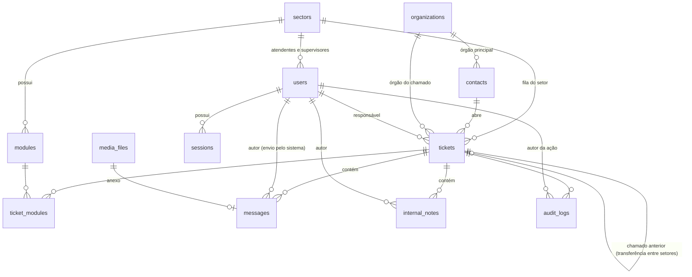
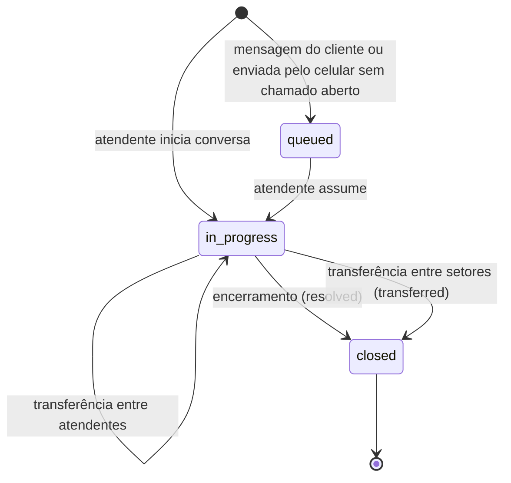

# Modelo de dados — Central de atendimento via WhatsApp

Domínios, entidades, ligações e regras de integridade. As regras de negócio estão em [spec.md](spec.md) e as decisões técnicas em [arquitetura.md](arquitetura.md).

Nomes de tabelas, colunas e valores estão em inglês, como no código. Todas as tabelas usam `id bigint generated always as identity` como chave primária e registram `created_at timestamptz not null default now()`; tabelas editáveis também têm `updated_at`. Horários são sempre `timestamptz`.

## Domínios

| Domínio | Pacote Go | Entidades | Responsabilidade |
| --- | --- | --- | --- |
| Organização interna | `internal/sector` | Setor, Módulo | Setores com seu número de WhatsApp e a lista de módulos de cada um |
| Acesso | `internal/auth` | Usuário, Sessão | Login, papéis e permissões |
| Cadastro de clientes | `internal/directory` | Órgão, Contato | Pessoas atendidas e os órgãos a que pertencem |
| Atendimento | `internal/ticket` | Chamado, Módulos do chamado, Nota interna, Contador de protocolo | Ciclo de vida do chamado: fila, responsável, transferências, encerramento e correções |
| Mensagens | `internal/message` | Mensagem, Arquivo | Histórico de mensagens e anexos |
| Mensageria | `internal/messaging` | — (sessões do Whatsmeow) | Interface de envio e recebimento e implementação com Whatsmeow |
| Auditoria | `internal/audit` | Registro de auditoria | Histórico de alterações relevantes |

Dependências permitidas: `ticket` usa `sector`, `auth`, `directory`, `message` e `audit`; `message` usa `messaging` para enviar; `messaging` não conhece nenhum outro domínio e só emite eventos.

## Diagrama

## Tipos enumerados

| Tipo | Valores | Significado |
| --- | --- | --- |
| `user_role` | `agent`, `supervisor`, `admin` | Atendente, supervisor do setor, administrador (supervisor global) |
| `connection_status` | `disconnected`, `connecting`, `connected`, `logged_out` | Estado da conexão do número do setor; `logged_out` exige novo QR code |
| `ticket_status` | `queued`, `in_progress`, `closed` | Na fila sem responsável, com responsável, encerrado |
| `closure_type` | `resolved`, `transferred` | Encerrado normalmente ou etapa encerrada por transferência entre setores |
| `message_direction` | `inbound`, `outbound` | Recebida do cliente ou enviada pelo setor |
| `message_origin` | `customer`, `agent`, `phone` | Enviada pelo cliente, por um atendente no sistema ou pelo celular fora do sistema |
| `message_type` | `text`, `image`, `video`, `audio`, `document`, `unsupported` | `unsupported` cobre figurinhas, reações, localização e outros tipos fora do piloto |
| `message_status` | `pending`, `sent`, `delivered`, `read`, `failed` | Situação de entrega das mensagens enviadas |

## Organização interna

### `sectors` — Setor

| Coluna | Tipo | Regras |
| --- | --- | --- |
| `name` | text | Obrigatório, único |
| `phone` | text | Obrigatório, único, somente dígitos com DDI (ex.: `5511999990000`) |
| `provider` | text | Obrigatório; provedor de mensageria do setor: `whatsmeow` (piloto) ou `cloud_api` (futuro) |
| `external_account_id` | text | Identificador da conta no provedor (no Whatsmeow, o JID do aparelho vinculado após o QR code) |
| `connection_status` | connection_status | Padrão `disconnected` |
| `last_connected_at` | timestamptz | Última conexão bem-sucedida |
| `active` | boolean | Padrão `true` |

### `modules` — Módulo/sistema atendido pelo setor

| Coluna | Tipo | Regras |
| --- | --- | --- |
| `sector_id` | bigint → `sectors` | Obrigatório |
| `name` | text | Obrigatório; único por setor (sem diferenciar maiúsculas) |
| `active` | boolean | Padrão `true` |

Módulos não são excluídos, apenas desativados, porque encerramentos antigos continuam referenciando-os. Módulos inativos não aparecem para novos encerramentos.

## Acesso

### `users` — Usuário

| Coluna | Tipo | Regras |
| --- | --- | --- |
| `name` | text | Obrigatório |
| `email` | text | Obrigatório, único (sem diferenciar maiúsculas) |
| `password_hash` | text | bcrypt |
| `role` | user_role | Obrigatório |
| `sector_id` | bigint → `sectors` | Obrigatório para `agent` e `supervisor`; vazio para `admin` |
| `active` | boolean | Padrão `true`; usuário inativo não faz login |

Restrição: `(role = 'admin') = (sector_id is null)`.

Usuários não são excluídos, apenas desativados, porque continuam como autores de mensagens, chamados e auditoria.

**Permissões:**

| Ação | Atendente | Supervisor | Administrador |
| --- | --- | --- | --- |
| Ver fila e chamados | Próprio setor | Próprio setor | Todos os setores |
| Assumir, responder, transferir, encerrar | Próprio setor | Próprio setor | Todos os setores |
| Corrigir chamado encerrado | Só os que encerrou | Próprio setor | Todos os setores |
| Gerenciar módulos | — | Próprio setor | Todos os setores |
| Redefinir senha | — | Usuários do próprio setor | Todos |
| Conectar número (QR code) e ver status | — | Próprio setor | Todos os setores |
| Cadastrar setores e usuários | — | — | Sim |
| Cadastrar contatos e vinculá-los a um órgão | Sim | Sim | Sim |
| Cadastrar e editar órgãos | — | Sim | Sim |

### `sessions` — Sessão de login

| Coluna | Tipo | Regras |
| --- | --- | --- |
| `token_hash` | text | Único; hash SHA-256 do token do cookie (o token em si nunca é gravado) |
| `user_id` | bigint → `users` | Obrigatório |
| `expires_at` | timestamptz | Obrigatório |
| `last_seen_at` | timestamptz | Atualizado no uso |

Um novo token é gerado a cada login. Desativar um usuário ou redefinir sua senha remove suas sessões. A expiração é deslizante: cada uso válido leva `expires_at` para 12 horas à frente.

## Cadastro de clientes

### `organizations` — Órgão

| Coluna | Tipo | Regras |
| --- | --- | --- |
| `name` | text | Obrigatório |
| `cnpj` | char(14) | Opcional; sem pontuação, com letras maiúsculas e dígitos (CNPJ numérico ou alfanumérico), validado pelos dígitos verificadores; único quando informado (índice único parcial) |

### `contacts` — Contato (pessoa física)

| Coluna | Tipo | Regras |
| --- | --- | --- |
| `name` | text | Obrigatório; para números desconhecidos, preenchido com o nome do perfil do WhatsApp ou o telefone |
| `phone` | text | Único quando preenchido, somente dígitos com DDI; obrigatório para contato cadastrado (vazio só em contato criado automaticamente sem telefone conhecido, identificado apenas por LID) |
| `external_contact_id` | text | Identificador do contato no provedor, usado para casar mensagens recebidas; único quando preenchido |
| `organization_id` | bigint → `organizations` | Órgão principal; vazio para contato ainda não vinculado |
| `registered` | boolean | `false` para contatos criados automaticamente a partir de número desconhecido; `true` após cadastro pelo atendente |

Restrições: `registered` ⇒ `organization_id` e `phone` preenchidos (contato cadastrado pelo atendente sempre tem órgão e telefone).

O cadastro de contatos e órgãos é único para todos os setores. Os órgãos são pré-cadastrados por supervisores e administradores; no atendimento, o atendente apenas vincula a pessoa a um órgão existente.

Busca: por nome do contato ou do órgão (índice `pg_trgm` para busca parcial, sem diferenciar maiúsculas nem acentos), por telefone e por CNPJ. Os acentos são removidos pela extensão `unaccent`, por meio da função `immutable_unaccent(text)`, que fixa o dicionário para poder ser usada nos índices de nome.

CNPJ: desde julho de 2026 a Receita Federal emite CNPJ alfanumérico (IN RFB 2.229/2024): as 12 primeiras posições aceitam letras maiúsculas e dígitos, e os 2 dígitos verificadores continuam numéricos. A validação usa o cálculo do módulo 11 com o valor de cada caractere igual ao código ASCII menos 48, que vale também para o CNPJ numérico. CNPJ com todos os caracteres iguais é recusado.

Casamento de mensagens recebidas: números brasileiros podem chegar com ou sem o nono dígito, e o WhatsApp pode identificar contatos por LID em vez do telefone. A mensagem é ligada ao contato pelo `external_contact_id` resolvido pelo adaptador. Sem contato com esse identificador, procura-se um contato sem `external_contact_id` pelo telefone ou por sua variante com ou sem o nono dígito (celular brasileiro: `55` + DDD + `9` + 8 dígitos ou `55` + DDD + 8 dígitos começando por 6 a 9); encontrado, ele passa a ter o identificador. Sem nenhum dos dois, é criado um contato com `registered = false`.

## Atendimento

### `tickets` — Chamado

| Coluna | Tipo | Regras |
| --- | --- | --- |
| `protocol` | text | Obrigatório, único; formato `AAAA-NNNNNN` |
| `sector_id` | bigint → `sectors` | Obrigatório |
| `contact_id` | bigint → `contacts` | Obrigatório |
| `organization_id` | bigint → `organizations` | Copiado do órgão principal do contato; editável no encerramento; obrigatório para encerrar |
| `assignee_id` | bigint → `users` | Responsável atual |
| `status` | ticket_status | Obrigatório |
| `previous_ticket_id` | bigint → `tickets` | Chamado de origem em transferência entre setores; único |
| `created_by_id` | bigint → `users` | Preenchido quando o atendente iniciou a conversa |
| `spoke_with` | text | "Falou com", para telefones usados por mais de uma pessoa |
| `arrived_at` | timestamptz | Obrigatório; primeira mensagem do chamado |
| `assigned_at` | timestamptz | Primeira vez que alguém assumiu; não muda em transferências |
| `started_at` | timestamptz | Obrigatório; padrão `arrived_at`; editável no encerramento |
| `ended_at` | timestamptz | Preenchido ao encerrar; editável |
| `closed_at` | timestamptz | Momento real do encerramento; não editável |
| `closed_by_id` | bigint → `users` | Quem encerrou |
| `closure_type` | closure_type | Preenchido ao encerrar |
| `subject` | text | Obrigatório para encerrar |
| `resolution` | text | Obrigatório para encerrar |

Restrições:

- `status = 'queued'` ⇒ `assignee_id` vazio.
- `status in ('in_progress', 'closed')` ⇒ `assignee_id` preenchido.
- `status = 'closed'` ⇒ `organization_id`, `ended_at`, `closed_at`, `closed_by_id`, `closure_type`, `subject` e `resolution` preenchidos.
- `ended_at >= started_at`.
- Índice único parcial em `(sector_id, contact_id) where status <> 'closed'`: um chamado aberto por contato e setor.
- Encerrar exige ao menos um registro em `ticket_modules` (validado na transação de encerramento).
- O contato do chamado precisa estar com `registered = true` para encerrar.

Índices: `(sector_id, status)` para a fila; `(assignee_id) where status = 'in_progress'` para a contagem por atendente; `(contact_id)` e `(organization_id)` para o histórico.

### `ticket_modules` — Módulos atendidos no chamado

| Coluna | Tipo | Regras |
| --- | --- | --- |
| `ticket_id` | bigint → `tickets` | Chave primária composta |
| `module_id` | bigint → `modules` | Chave primária composta; o módulo deve ser do setor do chamado |

### `internal_notes` — Nota interna

| Coluna | Tipo | Regras |
| --- | --- | --- |
| `ticket_id` | bigint → `tickets` | Obrigatório |
| `author_id` | bigint → `users` | Obrigatório |
| `body` | text | Obrigatório |

Notas não são editadas nem excluídas. Ficam visíveis para quem pode ver o chamado e, após transferência entre setores, para o setor de destino.

### `protocol_counters` — Contador de protocolo

| Coluna | Tipo | Regras |
| --- | --- | --- |
| `year` | integer | Chave primária |
| `last_value` | integer | Último número usado no ano |

O protocolo é gerado na mesma transação que cria o chamado, com `insert ... on conflict (year) do update set last_value = last_value + 1 returning last_value`. A numeração é única para todos os setores e reinicia a cada ano, contado no horário de Brasília (`America/Sao_Paulo`).

### Ciclo de vida do chamado

| Evento | Efeito |
| --- | --- |
| Mensagem do cliente sem chamado aberto no setor | Cria chamado `queued` com `arrived_at` = horário da mensagem |
| Mensagem do cliente com chamado aberto | Entra no chamado existente |
| Mensagem enviada pelo celular sem chamado aberto | Cria chamado `queued`; mensagem com origem `phone` |
| Atendente inicia conversa | Cria chamado `in_progress` com `assignee_id` e `created_by_id` = atendente e `arrived_at` = envio |
| Assumir | `update ... set assignee_id = :user, status = 'in_progress', assigned_at = coalesce(assigned_at, now()) where id = :id and status = 'queued'`; nenhuma linha afetada significa que outro atendente assumiu antes |
| Transferência entre atendentes | Troca `assignee_id`; auditoria `ticket_transferred_user` |
| Encerramento | Preenche os campos de encerramento com `closure_type = 'resolved'` e grava `ticket_modules` |
| Transferência entre setores | Encerra com o formulário completo e `closure_type = 'transferred'`; cria chamado `queued` no destino com `previous_ticket_id`, mesmo contato e órgão, e `arrived_at` = momento da transferência |
| Mensagem após encerramento | Cria novo chamado (não reabre) |

Chamados não são reabertos. O destino de uma transferência entre setores vê o histórico seguindo a cadeia de `previous_ticket_id`.

## Mensagens

### `messages` — Mensagem

| Coluna | Tipo | Regras |
| --- | --- | --- |
| `ticket_id` | bigint → `tickets` | Obrigatório |
| `sector_id` | bigint → `sectors` | Obrigatório; número pelo qual a mensagem passou |
| `contact_id` | bigint → `contacts` | Obrigatório |
| `direction` | message_direction | Obrigatório |
| `origin` | message_origin | Obrigatório |
| `author_id` | bigint → `users` | Obrigatório quando `origin = 'agent'`; vazio nos demais |
| `type` | message_type | Obrigatório |
| `body` | text | Texto ou legenda |
| `media_id` | bigint → `media_files` | Anexo, quando houver |
| `external_message_id` | text | Identificador da mensagem no provedor; preenchido na recepção ou após o envio aceito |
| `client_request_id` | uuid | Gerado pela interface a cada envio; impede envio duplicado em clique duplo ou nova tentativa |
| `status` | message_status | Usado nas mensagens enviadas |
| `failure_reason` | text | Motivo quando `status = 'failed'` |
| `sent_at` | timestamptz | Obrigatório; horário da mensagem segundo o WhatsApp |

Restrições:

- Único em `(sector_id, external_message_id)` quando preenchido: garante idempotência em reconexões e reentregas.
- Único em `client_request_id` quando preenchido: garante idempotência no envio pelo sistema.
- `direction = 'inbound'` ⇔ `origin = 'customer'`.
- `type in ('image', 'video', 'audio', 'document')` ⇒ `media_id` preenchido.

Índice: `(ticket_id, sent_at)` para exibir a conversa.

Mensagens enviadas pelo celular fora do sistema (`origin = 'phone'`) são gravadas com `status = 'sent'`, sem autor.

Mensagens não são editadas nem excluídas.

### `media_files` — Arquivo

| Coluna | Tipo | Regras |
| --- | --- | --- |
| `storage_key` | text | Obrigatório, único; caminho na interface de armazenamento |
| `mime_type` | text | Obrigatório |
| `size_bytes` | bigint | Obrigatório |
| `file_name` | text | Nome original, quando houver |
| `sha256` | text | Obrigatório |
| `duration_seconds` | integer | Áudio e vídeo |

O arquivo é gravado no armazenamento antes de a mensagem ser confirmada no banco.

## Auditoria

### `audit_logs` — Registro de auditoria

| Coluna | Tipo | Regras |
| --- | --- | --- |
| `ticket_id` | bigint → `tickets` | Preenchido em ações sobre chamados |
| `entity_type` | text | Ex.: `ticket`, `user`, `sector`, `module` |
| `entity_id` | bigint | Obrigatório |
| `action` | text | Ver tabela abaixo |
| `actor_id` | bigint → `users` | Quem fez; vazio para ações do sistema |
| `reason` | text | Obrigatório em correções |
| `changes` | jsonb | Valores anteriores e novos: `{"campo": {"from": ..., "to": ...}}` |

Índices: `(ticket_id, created_at)` e `(entity_type, entity_id)`.

A tabela é criada na T03 (primeira ação auditada: redefinição de senha), antes de existir `tickets`; a chave estrangeira de `ticket_id` é adicionada na migração que cria `tickets`.

| Ação | Quando |
| --- | --- |
| `ticket_assigned` | Atendente assume chamado |
| `ticket_transferred_user` | Transferência entre atendentes |
| `ticket_transferred_sector` | Transferência entre setores (no chamado de origem) |
| `ticket_closed` | Encerramento, incluindo horários e órgão alterados no formulário |
| `ticket_corrected` | Correção de chamado encerrado (exige `reason`) |
| `user_created`, `user_updated`, `user_password_reset` | Administração de usuários |
| `sector_created`, `sector_updated`, `sector_connected`, `sector_disconnected` | Administração e conexão de setores |
| `module_created`, `module_updated` | Administração de módulos |
| `organization_created`, `organization_updated` | Administração de órgãos |

Conexão do número: `sector_connected` é gravado quando o setor passa a `connected` vindo de outro estado ou com outra conta vinculada; `sector_disconnected`, quando sai de `connected`. Os estados intermediários (`connecting`) e as reconexões automáticas que não passam por `connected` não geram auditoria. Os dois registros são ações do sistema (`actor_id` vazio) e guardam em `changes` o estado da conexão e a conta vinculada.

Registros de auditoria nunca são alterados nem excluídos.

## Sessões do Whatsmeow

O Whatsmeow cria e mantém as próprias tabelas (prefixo `whatsmeow_`) no mesmo banco, por meio do `sqlstore`. Elas não são alteradas pelas migrações do sistema; a ligação com o setor é feita por `sectors.external_account_id`. Essas tabelas pertencem ao adaptador Whatsmeow e deixam de existir quando todos os setores migrarem para a API oficial.
